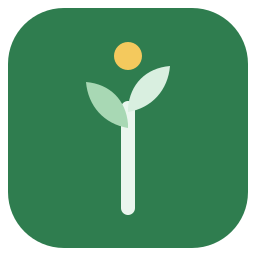

  

# Om Þrífast

**Hvad er Þrífast?**
Þrífast er et enkelt sted til at tale om børn. Her kan vi dele erfaringer, stille spørgsmål og koordinere hverdagen med skole og klub, så vi kan støtte hinanden i børnenes dagligdag.

**Hvorfor navnet?**
Navnet kommer fra det oldnordiske ord *þrífast*, som betyder "at trives" eller "at blomstre". Det er det, vi alle ønsker for vores børn: At de trives og har det godt.

**Kort og godt:**
En app til forældre. Et rum til samtale og koordinering. Fokus på børnenes trivsel.

**Velkommen til Þrífast.**
